# Deepal S05 Card

[English](README.md) · **Ελληνικά** · [Español](README.es.md)

Κάρτα Lovelace για το **Deepal S05** (EV και PHEV) που μοιάζει και λειτουργεί σαν την εφαρμογή του κατασκευαστή.
Δουλεύει με το integration [Deepal Alternative](https://github.com/Sunek0/ha-deepal-alternative) (domain `deepal`).

> **Ανεπίσημο.** Το project δεν συνδέεται με τη Deepal, τη Changan ή τους δημιουργούς του integration.
> Τα κουμπιά στέλνουν **πραγματικές εντολές σε πραγματικό όχημα** (κλείδωμα/ξεκλείδωμα, παράθυρα, πορτμπαγκάζ, κλιματισμός, κόρνα…).
> Χρησιμοποίησέ τα με την ίδια προσοχή όπως στην επίσημη εφαρμογή.

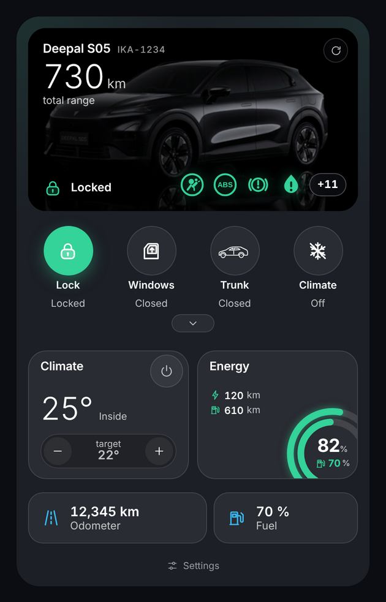

## Εικόνες

| | |
|---|---|
| 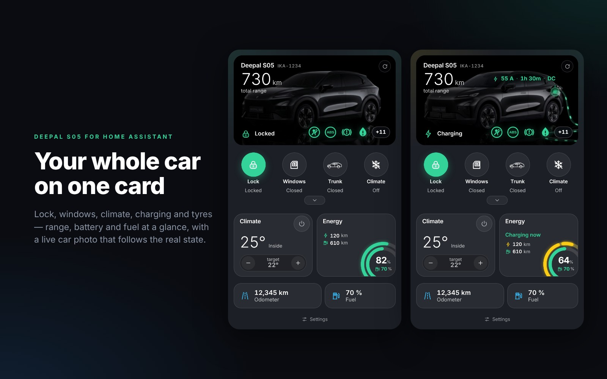 | 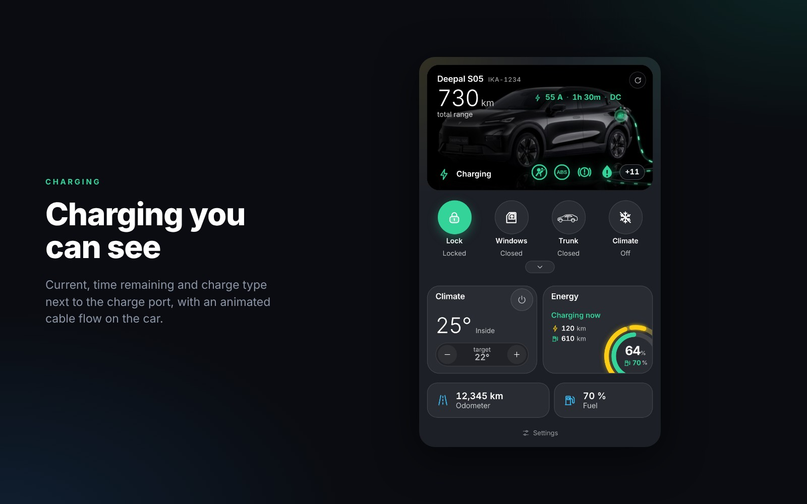 |
| 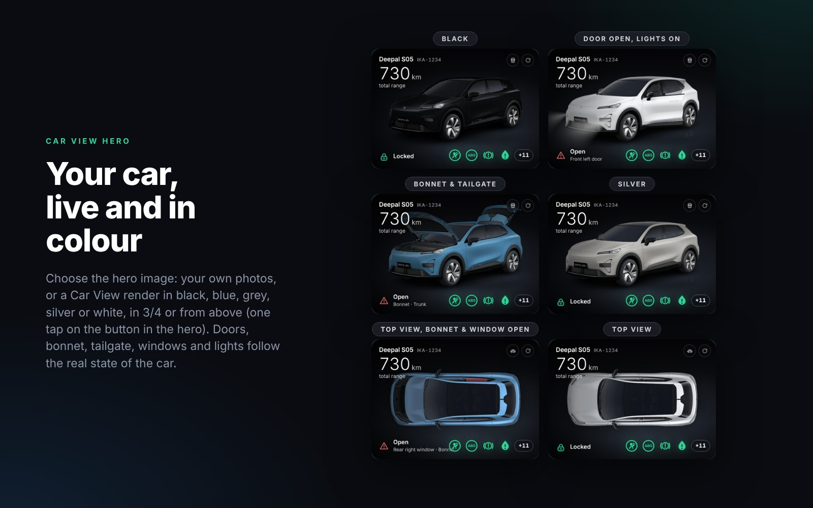 | 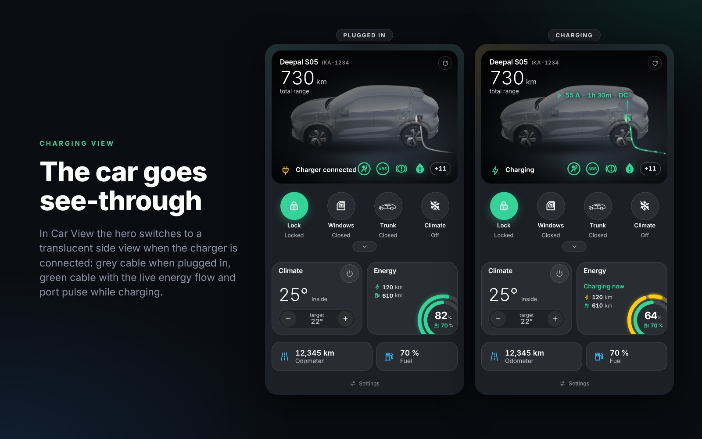 |
| 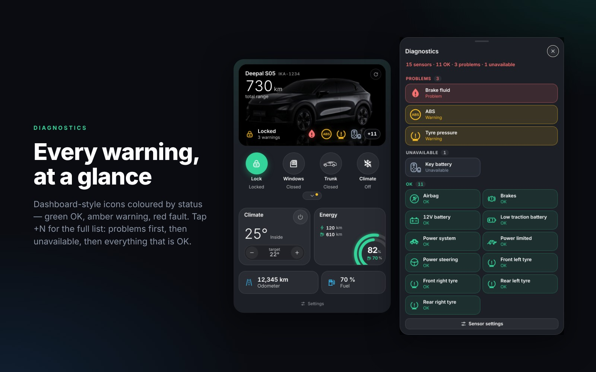 |  |
| 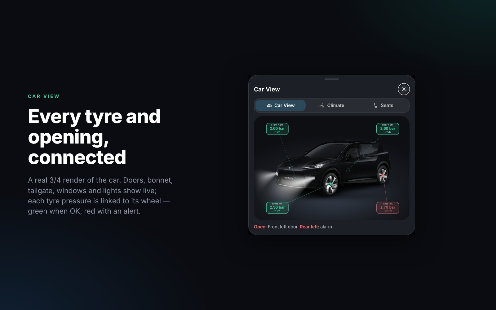 |  |
| 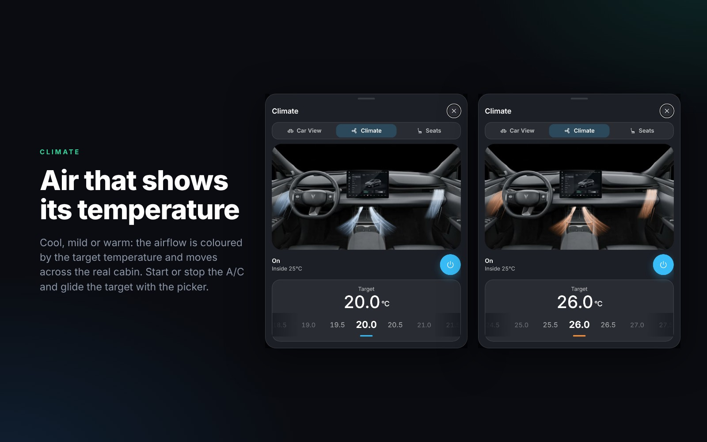 | 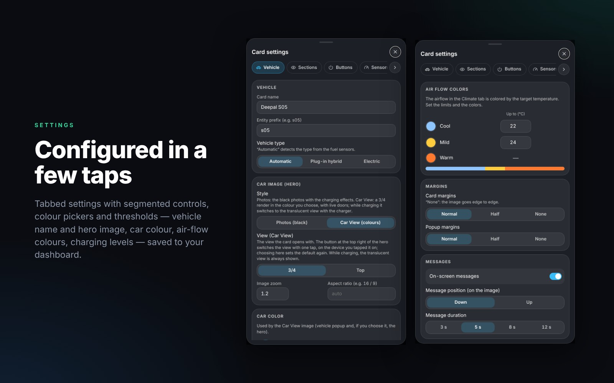 |
|  |  |
| 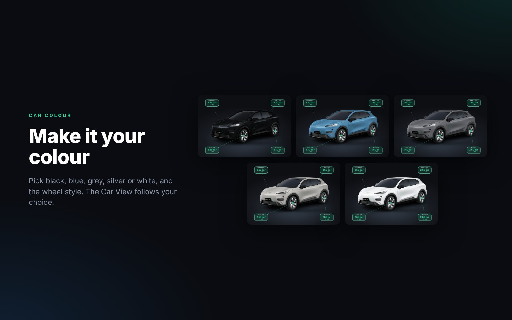 | 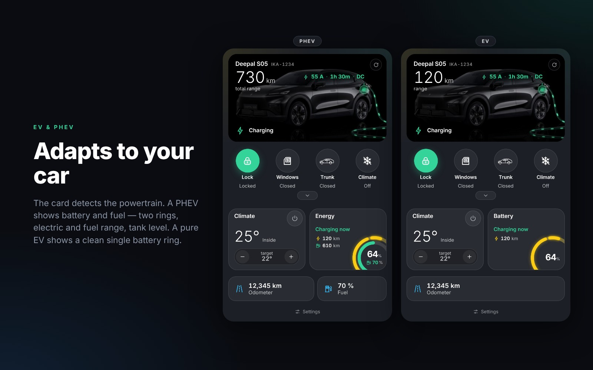 |

_(Οι εικόνες είναι στα Αγγλικά.)_

## Χαρακτηριστικά

- Φωτογραφία του αμαξιού που αλλάζει ανάλογα με την κατάσταση (σβηστό, φώτα, ξεκλείδωτο, φόρτιση, ολοκλήρωση φόρτισης).
- **Στυλ hero** (*Ρυθμίσεις → Όχημα*): οι δικές σου φωτογραφίες ή ζωντανό render **Car View** σε μαύρο, μπλε, γκρι, ασημί ή λευκό, με πόρτες, καπό, πορτμπαγκάζ, παράθυρα και φώτα που ακολουθούν το αμάξι, σε 3/4 ή **από πάνω** (ένα κουμπί στο hero αλλάζει την προβολή με ένα πάτημα· το *Ρυθμίσεις → Όχημα → Προβολή* ορίζει την προεπιλογή). Όταν συνδεθεί ο φορτιστής, το αμάξι αλλάζει σε διάφανη πλάγια όψη με γκρι καλώδιο (συνδεδεμένο) ή πράσινο καλώδιο με τα ίδια εφέ ροής ενέργειας και παλμού στη θύρα (φόρτιση).
- Στρογγυλά κουμπιά ελέγχου: κλείδωμα, παράθυρα, πορτμπαγκάζ, κλιματισμός, ελαστικά, εσωτερικό, αναλαμπή φώτων, κόρνα, εύρεση αμαξιού — διάταξη, ετικέτες, μέγεθος, σειρά και ορατότητα ρυθμίζονται.
- Δαχτυλίδια αυτονομίας, μπαταρίας (και καυσίμου στο PHEV)· ο δακτύλιος της μπαταρίας κινείται όσο φορτίζει.
- Κατάσταση φόρτισης: ρεύμα, χρόνος που απομένει και τύπος ως κείμενο δίπλα στη θύρα φόρτισης (4 στυλ), και προαιρετικό κινούμενο εφέ πάνω στο αμάξι (ροή στο καλώδιο / παλμός στη θύρα / σάρωση φωτός).
- Popup **Car View**: πραγματικό render 3/4 του αμαξιού σε πέντε χρώματα με πόρτες, καπό, πορτμπαγκάζ, παράθυρα και φώτα ζωντανά, και τις τέσσερις πιέσεις ελαστικών συνδεδεμένες με τους τροχούς τους (πράσινο OK / κόκκινο ειδοποίηση).
- Popup κλιματισμού με επιλογέα θερμοκρασίας και κινούμενη ροή αέρα που παίρνει χρώμα από τη θερμοκρασία-στόχο, καθώς και θέρμανση/αερισμό καθισμάτων και θέρμανση τιμονιού.
- Διαγνωστικά ως μεγάλα εικονίδια τύπου ταμπλό με χρώμα ανά κατάσταση (airbag, ABS, φρένα, ελαστικά, μπαταρία 12 V…). Πάτα «+N» για τη λίστα όλων των αισθητήρων· νέοι αισθητήρες ανακαλύπτονται με ένα κουμπί.
- Δικά σου πλακίδια πληροφοριών: πρόσθεσε οποιονδήποτε αισθητήρα.
- **EV ή PHEV**: τα στοιχεία καυσίμου κρύβονται αυτόματα όταν το όχημα δεν έχει αισθητήρες καυσίμου (ή το ορίζεις στις ρυθμίσεις).
- **Γλώσσες**: Αγγλικά, Ισπανικά και Ελληνικά περιλαμβάνονται· ακολουθεί τη γλώσσα του Home Assistant. Κάθε νέα γλώσσα είναι ένα μικρό αρχείο ([πώς](docs/LANGUAGES.md)).
- **Ρυθμίσεις μέσα στην κάρτα** (και στον επεξεργαστή κάρτας). Αποθηκεύονται στο YAML της κάρτας, άρα ισχύουν σε όλες τις συσκευές και τους χρήστες.
- Χωρίς εξαρτήσεις και CDN: ένα αρχείο JavaScript + τοπικές εικόνες.

## Απαιτήσεις

- Home Assistant **2026.3.0** ή νεότερο.
- Το integration [Deepal Alternative](https://github.com/Sunek0/ha-deepal-alternative) με το όχημά σου προστεθειμένο.
- Τα ονόματα των οντοτήτων εντοπίζονται αυτόματα — δες [Πώς βρίσκονται οι οντότητες](#πώς-βρίσκονται-οι-οντότητες).

## Εγκατάσταση

### HACS (προτείνεται)

1. HACS → ⋮ → **Custom repositories** → πρόσθεσε `https://github.com/rmxs/deepal-s05-card`, κατηγορία **Dashboard**.
2. Εγκατάστησε το **Deepal S05 Card** και κάνε επαναφόρτωση του browser (hard refresh).
3. Το HACS καταχωρεί το resource μόνο του. Αν όχι, πρόσθεσέ το χειροκίνητα:
   *Ρυθμίσεις → Dashboards → ⋮ → Resources* → `/hacsfiles/deepal-s05-card/deepal-s05-card.js`, τύπος **JavaScript module**.

### Χειροκίνητα

1. Αντίγραψε τα περιεχόμενα του φακέλου `dist/` στο `/config/www/deepal-s05-card/` (ώστε το `deepal-s05-card.js`, το `lang/` και το `images/` να είναι δίπλα-δίπλα).
2. Πρόσθεσε το resource `/local/deepal-s05-card/deepal-s05-card.js` ως **JavaScript module** και κάνε hard refresh στον browser.

## Χρήση

Πρόσθεσε την κάρτα από τον επιλογέα καρτών (**Deepal S05 Control Panel**) ή με YAML:

```yaml
type: custom:deepal-s05-card
prefix: s05          # πρόθεμα οντοτήτων, π.χ. sensor.s05_battery_level  (προαιρετικό, εντοπίζεται αυτόματα)
name: Deepal S05
```

Όλα τα υπόλοιπα αλλάζουν από το κουμπί **Ρυθμίσεις** στο κάτω μέρος της κάρτας ή από τον οπτικό επεξεργαστή.
Η πλήρης λίστα επιλογών υπάρχει στο [docs/CONFIG.md](docs/CONFIG.md).

## Πώς βρίσκονται οι οντότητες

1. Η κάρτα φτιάχνει το id της οντότητας από το `prefix` (`sensor.<prefix>_battery_level`, `lock.<prefix>_doors`, …).
2. Αν το πρόθεμα δεν ταιριάζει με τίποτα, ψάχνει το πρόθεμα που έχει τους αισθητήρες του οχήματος (π.χ. `mycar_`).
3. Αν το id διαφέρει από το αναμενόμενο (π.χ. επειδή το Home Assistant είναι σε άλλη γλώσσα και τα μεταφρασμένα ονόματα του integration δίνουν άλλα ids), η κάρτα βρίσκει την οντότητα μέσω του registry με το σταθερό `translation_key` του integration.
4. Κάθε οντότητα μπορεί να αντιστοιχιστεί και χειροκίνητα στο *Ρυθμίσεις → Αισθητήρες → Αντιστοίχιση οντοτήτων*.

Ο επιλογέας θερμοκρασίας-στόχου χρησιμοποιεί απευθείας την οντότητα `climate.<prefix>_cabin_climate` — δεν χρειάζεται helper.

## Φωτογραφίες και layers

Η κάρτα εμφανίζει φωτογραφίες από το `images/car/` (hero), τα layers του Car View από το `images/iso/<χρώμα>/` και τα layers του εσωτερικού από το `images/interior/` την όψη από πάνω από το `images/top/<χρώμα>/` και τη διάφανη όψη φόρτισης από το `images/carga/`, όλα δίπλα στο αρχείο της κάρτας (το HACS τα εγκαθιστά μαζί με την κάρτα).
Οι φωτογραφίες hero είναι φτιαγμένες για **μαύρο Deepal S05**· το Car View διατίθεται σε πέντε χρώματα (*Ρυθμίσεις → Όχημα → Χρώμα αμαξιού*) και μπορεί να χρησιμοποιηθεί και ως hero (*Ρυθμίσεις → Όχημα → Στυλ hero*). Για άλλο μοντέλο αντικατέστησε τα αρχεία (ίδια ονόματα) ή δείξε στην κάρτα δικό σου φάκελο στο *Ρυθμίσεις → Εικόνες*.
Για την προέλευση και τις άδειες των εικόνων δες το [THIRD_PARTY_NOTICES.md](THIRD_PARTY_NOTICES.md).

## Αντιμετώπιση προβλημάτων

| Πρόβλημα | Λύση |
|---|---|
| «Vehicle images not found» | Ο φάκελος `images/` δεν είναι δίπλα στο αρχείο της κάρτας. Ενημέρωσε στην 1.2.2 ή νεότερη μέσω HACS (οι προηγούμενες εκδόσεις έφερναν από το HACS μόνο το αρχείο `.js`). Αν οι φάκελοι λείπουν ακόμα μετά την ενημέρωση, κάνε επανεκκίνηση του Home Assistant και HACS → η κάρτα → ⋮ → **Redownload**· ή αντίγραψε όλο το περιεχόμενο του `dist/`. |
| Όλες οι τιμές δείχνουν `--` | Λάθος πρόθεμα. Όρισε `prefix:` με το κομμάτι ανάμεσα στο domain και το όνομα του αισθητήρα (`sensor.`**`s05`**`_battery_level`). |
| Οι ρυθμίσεις δεν αποθηκεύονται στο YAML | Χρειάζεται λογαριασμός διαχειριστή και dashboard που διαχειρίζεται το UI. Αλλιώς αποθηκεύονται στο προφίλ χρήστη και μπορείς να αντιγράψεις το YAML από *Ρυθμίσεις → Γενικά*. |
| Τα κουμπιά δεν κάνουν τίποτα | Το integration αναφέρει ότι οι απομακρυσμένες εντολές στο S05 είναι πειραματικές και χρειάζονται το PIN τηλεχειρισμού. |
| Μετά από ενημέρωση βλέπω παλιά εμφάνιση | Κάνε hard refresh (Ctrl+F5)· αν χρειαστεί, καθάρισε την cache του browser ή της εφαρμογής HA. |

## Ανάπτυξη

```bash
bash scripts/build.sh      # φτιάχνει το dist/deepal-s05-card.js από το src/
```

Άλλαξε τα αρχεία στο `src/`, τρέξε το build και κάνε commit και `src/` και `dist/`.
Οι εικόνες του Car View μετατρέπονται από τα renders του dec_deepal με το `tools/build_iso.py`, την όψη από πάνω (ξαναχρωματισμένη από το ασημί original) με το `tools/build_planta.py`, την όψη φόρτισης με το `tools/build_carga.py` και τα layers του εσωτερικού με το `tools/build_layers.py` (δες την επικεφαλίδα κάθε script).

## Άδεια

MIT — Copyright (c) 2026 L.K. Δες το [LICENSE](LICENSE). Υλικό τρίτων: [THIRD_PARTY_NOTICES.md](THIRD_PARTY_NOTICES.md).
